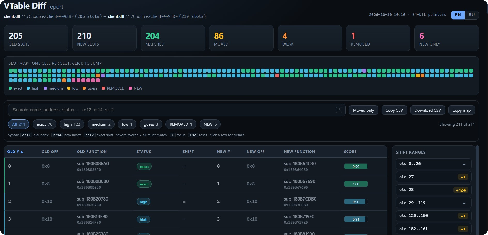
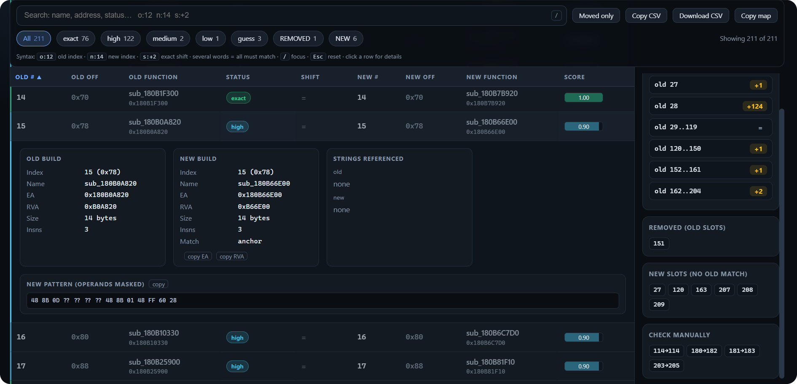
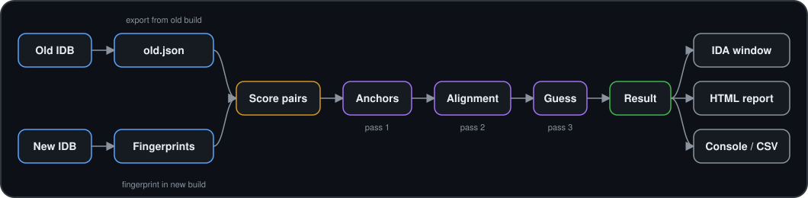

<div align="center">

# VTable Diff

**Track virtual function index shifts between two builds of the same module**

IDA Pro 9.0+ plugin for vtable diffing. Matches slots by what the functions actually do, not by index.


<p align="center">
  
  
</p>

<sub>IDA window with the slot table and the interactive HTML report</sub>

</div>

---

## The problem

A game or app update adds one virtual method, and every vtable index after it shifts. Signatures, hooks and hardcoded offsets silently break.

<table>
<tr>
<th align="center">OLD build</th>
<th align="center">NEW build</th>
<th align="center">Result</th>
</tr>
<tr>
<td><pre>[0] Init
[1] Think
[2] Render
[3] Shutdown</pre></td>
<td><pre>[0] Init
[1] Think
[2] OnSpawn
[3] Render
[4] Shutdown</pre></td>
<td><pre>Init      0
Think     0
OnSpawn   NEW
Render   +1
Shutdown +1</pre></td>
</tr>
</table>

Matching by index gives a wrong answer for everything after the insertion. VTable Diff reports the exact shift for every slot and groups them into ranges, so you know precisely what to add to your old indices.

---

## At a glance

<table>
<tr>
<td width="50%" valign="top">

**Input**<br>
One vtable from the old IDB, one from the new IDB

**Locate a vtable by**<br>
Address, symbol name, or RTTI class name (works on stripped MSVC x64/x86)

**Output**<br>
IDA window, interactive HTML report, console dump, CSV export

</td>
<td width="50%" valign="top">

**Matching**<br>
3 passes: anchors, order-preserving alignment, positional guess

**Confidence labels**<br>
`exact` `high` `medium` `low` `guess` `REMOVED` `NEW`

**Limits**<br>
Up to 4096 slots, up to 3000 instructions per function

**Footprint**<br>
Single file, about 1600 lines, no dependencies

</td>
</tr>
</table>

---

## Features

- **Export a vtable to JSON**: addresses, names and a full fingerprint of every virtual function.
- **Compare against the new build**: slots are matched by function similarity, not by index position.
- **Shift detection**: per-slot shift (`+2`, `-1`) and grouped ranges, for example "old slots 10..99 moved by +2 (+16 bytes on x64)".
- **Built-in triage**: low-confidence and guessed matches, plus added and removed slots, are highlighted. Check those by hand first.
- **RTTI lookup**: finds vtables by class name, including multiple inheritance (this-offset shown in the picker).
- **Automatic slot count**: scans for pointers into executable code.
- **Thunk resolution**: `jmp real_func` stubs are followed to the real function.
- **Name transfer**: copies your user-defined names from the old database to confidently matched slots in the new one.
- **HTML report**: search, status filters, sorting, per-function details, match highlighting and CSV export. Shareable without opening IDA.

---

## Pipeline

<p align="center">
  
</p>

---

## Methods in detail

<details>
<summary><b>1. Locating a vtable (address, symbol, RTTI)</b></summary>
<br>

The input is resolved in order:

1. a hex string of 5 to 16 digits is used as a direct address;
2. otherwise it is looked up as a symbol name (`??_7X@@6B@`);
3. otherwise it is treated as an RTTI class name.

RTTI lookup works on stripped MSVC binaries by walking the structures backwards:

```
".?AVClassName@@"  (name string)
        |  minus 2 pointers
        v
TypeDescriptor
        |  referenced at COL + 12  (RVA on x64, absolute on x86)
        v
RTTI Complete Object Locator   (signature 1 on x64, 0 on x86, pSelf verified)
        |  pointer to COL sits right before the vtable
        v
vtable = address of that pointer + pointer size
```

The COL also carries the **this-offset**, which identifies secondary vtables under multiple inheritance. If several candidates are found, a picker lists address, slot count, this-offset, COL and symbol, and preselects the one whose slot count is closest to the old build.

The **slot count** is detected by walking pointers while they point into an executable segment, stopping at the first non-code pointer or at an address with a user-defined name. You can override it.

</details>

<details>
<summary><b>2. Function fingerprint</b></summary>
<br>

For every slot the plugin analyzes the function (creating it if IDA has none), up to 3000 instructions, and collects:

| Signal | What is collected | Why |
|---|---|---|
| Mnemonics | Sequence of instruction mnemonics | Shape of the code |
| Strings | String literals referenced by the code | Strongest identity signal |
| Calls | Names of called functions and read data (`d:` prefix) | Behavior; only meaningful names are kept |
| Constants | Immediates of 0x100 and above, excluding image-range addresses | Magic numbers, flags |
| Offsets | `[reg+disp]` displacements | Indirectly the layout of structures |
| Byte pattern | Raw bytes with address operands replaced by `??` | Survives rebasing and moved data |

Auto-generated names (`sub_`, `loc_`, `off_`, `unk_`, ...) are ignored because they change between builds. Single-instruction `jmp` thunks are followed (up to 3 levels) to the real function. MD5 hashes of the pattern and the mnemonic sequence are stored for fast equality checks.

</details>

<details>
<summary><b>3. Similarity score for a pair of functions</b></summary>
<br>

- **Identical masked byte pattern**: score `1.0` (`0.9` for trivial functions of 4 instructions or fewer).
- **Otherwise** a weighted average of these components:

| Component | Weight | Metric |
|---|---|---|
| Mnemonic sequence | 3.0 | `difflib.SequenceMatcher` ratio (multiset overlap for functions over 500 instructions) |
| Strings | 3.0 | Jaccard index |
| Calls | 1.5 | Jaccard index |
| Constants | 1.5 | Jaccard index |
| Offsets | 1.0 | Jaccard index |
| Size | 1.0 | `min / max` |

A component whose set is empty on both sides is skipped instead of counting as zero, so functions without strings are not penalized. Trivial functions are capped at `0.85` because they carry too little signal to be sure.

The score is computed for every old slot against every new slot, which gives a full similarity matrix.

</details>

<details>
<summary><b>4. Three-pass matching</b></summary>
<br>

**Pass 1: anchors.** A pair becomes an anchor if its score is at least `0.85`, it is the best in its row and its column, and it leads the runner-up by at least `0.05` in both. Anchors are the obvious matches.

**Pass 2: aligned.** Anchors can cross each other, so the longest increasing subsequence (LIS) of anchors is taken as an order-preserving skeleton. In each gap between skeleton anchors, **Needleman-Wunsch** alignment maximizes total similarity while keeping slot order. Gap penalty is `0.1`, pairs below `0.35` are not accepted.

**Pass 3: guess.** If a gap still contains the same number of old and new unmatched slots, they are paired by position and labeled `guess`.

Slots left without a pair become `REMOVED` (old only) or `NEW` (new only).

</details>

<details>
<summary><b>5. Confidence labels and shifts</b></summary>
<br>

| Label | Condition |
|---|---|
| `exact` | score at least 0.97 |
| `high` | score at least 0.80 |
| `medium` | score at least 0.55 |
| `low` | below 0.55 |
| `guess` | matched in pass 3 by position only |
| `REMOVED` / `NEW` | no counterpart |

Shift is `new index - old index`. Neighboring slots with the same shift are merged into a range: if two methods were inserted at slot 10 of a 100-slot vtable, slots `0..9` have shift `0` and slots `10..99` have shift `+2` (`+16` bytes on x64).

</details>

---

## Installation

1. Download `vtable_diff.py` (see [Releases](../../releases)).
2. Copy it into the `plugins` directory of your IDA Pro installation.
3. Restart IDA Pro.
4. Check `Edit → Plugins`: you should see `VTable Diff: export` and `VTable Diff: compare`.

The hotkey <kbd>Ctrl</kbd>+<kbd>Alt</kbd>+<kbd>V</kbd> opens a short Export / Compare dialog at any time.

---

## Usage

<table>
<tr>
<td width="50%" valign="top">

**Step 1. Export (old build)**

1. Open the **old** binary in IDA Pro.
2. Optionally put the cursor on the vtable (used as a default hint).
3. `Edit → Plugins → VTable Diff: export`
4. Enter an address, symbol or RTTI class name.
5. Pick a candidate if several are found.
6. Confirm the slot count and save the `*.json`.

</td>
<td width="50%" valign="top">

**Step 2. Compare (new build)**

1. Open the **new** binary in IDA Pro.
2. `Edit → Plugins → VTable Diff: compare`
3. Select the JSON from step 1.
4. Enter the matching vtable in the new database.
5. Confirm the slot count.
6. View the result as an **IDA window** (double-click to jump), an **HTML report**, or a **console dump**.

</td>
</tr>
</table>

### How to specify a vtable

| Format | Example | Description |
|---|---|---|
| Address (hex) | `0x180045A10` | Direct address of the vtable |
| Symbol name | `??_7CBaseEntity@@6B@` | Exact vftable symbol name |
| RTTI class name | `CSource2Client` | RTTI lookup (works on stripped x64/x86 MSVC) |

---

## Reading the result

<table>
<tr>
<th>Label</th>
<th>Meaning</th>
<th>What to do</th>
</tr>
<tr><td><code>exact</code></td><td>Identical byte pattern</td><td>Trust</td></tr>
<tr><td><code>high</code></td><td>High similarity</td><td>Trust</td></tr>
<tr><td><code>medium</code></td><td>Medium similarity</td><td>Worth a look</td></tr>
<tr><td><code>low</code></td><td>Low confidence</td><td>Check manually</td></tr>
<tr><td><code>guess</code></td><td>Matched by position only</td><td>Check manually</td></tr>
<tr><td><code>REMOVED</code></td><td>In old vtable, no match in new</td><td>Method removed or heavily rewritten</td></tr>
<tr><td><code>NEW</code></td><td>Only in new vtable</td><td>Method added</td></tr>
</table>

<!--
TODO: add a real-world example here
Class: ..., old build -> new build
Slots: N -> M, matched X (Y weak), removed A, new B, shift ranges R
Which hooks / signatures needed fixing as a result
-->

---

## Requirements

- IDA Pro 9.0 and newer (all 9.x versions and above; uses the `ida_*` Python API modules)
- Python 3 (bundled with IDA)
- No external dependencies, only the Python standard library and the IDA SDK

## Known limitations

- RTTI lookup by class name targets the MSVC ABI (x86/x64). Itanium ABI (GCC/Clang) is not supported.
- Match quality depends on how much signal a function carries (strings, calls, constants). Confidence is intentionally capped for very small, trivial functions.
- Up to 4096 slots and 3000 instructions per function are analyzed per pass (`MAX_ENTRIES` / `MAX_INSN`).
- Every old slot is scored against every new slot, so very large vtables are CPU-heavy.

## License

MIT, see [LICENSE](LICENSE).
